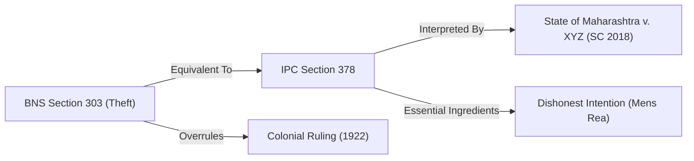

# Black-Coat: Future Architecture Evolution

This document specifies the target architecture for Black-Coat as it scales from a single free-tier JVM modular monolith to a high-concurrency, distributed legal intelligence platform.

---

## 1. Architectural Evolution Roadmap

```mermaid
flowchart TD
    subgraph Phase1["Phase 1: Present (Modular Monolith)"]
        Client["Web / Mobile / WhatsApp"]
        JVM["Single Spring Boot JVM<br>(auth, chat, rag, llm modules)"]
        PG["PostgreSQL (pgvector + FTS)<br>Users, Chats, Law Corpus"]
        FreeLLMs["Free LLM Fallback Chain<br>(Gemini → Groq → Ollama)"]
        
        Client --> JVM
        JVM --> PG
        JVM --> FreeLLMs
    end

    subgraph Phase2["Phase 2: Scale (Distributed Services)"]
        API_GW["Kong / Spring Cloud Gateway<br>(Rate Limiting, JWT, WAF)"]
        AuthSvc["Auth & Tenant Service"]
        ChatSvc["Chat & Quota Service"]
        RagSvc["Distributed RAG Service<br>(gRPC Streaming)"]
        
        RRF["Hybrid Retrieval (HNSW + FTS)"]
        Rerank["Cross-Encoder Reranker<br>(BGE-Reranker-Large)"]
        GraphDB["Legal Knowledge Graph<br>(Neo4j / Apache AGE)"]
        VLLM["Self-Hosted SLM Cluster<br>(BlackCoat-7B via vLLM)"]
        
        API_GW --> AuthSvc
        API_GW --> ChatSvc
        ChatSvc --> RagSvc
        RagSvc --> RRF
        RRF --> Rerank
        Rerank --> GraphDB
        GraphDB --> VLLM
    end
```



---

## 2. Key Architectural Pillars for Future Scale

### 2.1 Microservices Extraction via ArchUnit Boundaries
Because Black-Coat is strictly architected as a modular monolith with ArchUnit boundaries (`chat` calls `rag`, but `rag` never calls `chat`), extracting services requires zero business logic rewrite:
1. **`black-coat-rag` (gRPC / High-Performance Microservice):**
   - High memory allocation for vector index caching.
   - Dedicated gRPC streaming interface for token throughput.
2. **`black-coat-chat` (Event-Driven State Engine):**
   - Handles conversation persistence, quotas, and Kafka event publishing for analytics.
3. **`black-coat-auth` & User Management:**
   - Centralized authentication, DPDP consent tracking, and organization multi-tenancy.

---

### 2.2 Cross-Encoder Neural Reranking Stage
Currently, Black-Coat merges vector top-20 and full-text top-20 using Reciprocal Rank Fusion (RRF). In high-volume production, an intermediate **Cross-Encoder Reranker** will be introduced:

```
User Query + Candidate Statutes (Top 40 from RRF)
                      │
                      ▼
┌────────────────────────────────────────────────────────┐
│ Cross-Encoder Stage (BGE-Reranker-v2-m3 / Cohere)     │
│ Computes deep token-level cross-attention score        │
└────────────────────────────────────────────────────────┘
                      │
                      ▼
Keep Top 5 (Relevance Score > 0.85) → Feed to Prompt Builder
```
**Benefits:**
- Eliminates false positives when a statute mentions keywords but lacks contextual relevance.
- Enables smaller LLM context windows, reducing latency and operational inference costs.

---

### 2.3 Legal Knowledge Graph (Statute-to-Precedent Linking)
Statutory provisions in Indian law are interpreted through landmark Supreme Court of India (SCI) and High Court judgments. The future architecture introduces a graph database (Neo4j or PostgreSQL Apache AGE):



**Graph Capabilities:**
- **Precedent Mapping:** Automatically link any BNS section to its corresponding historical IPC case laws.
- **Overruled Law Alerts:** Warn users if a cited judgment has been overruled by a larger Supreme Court bench.
- **Constitutional Validity Tracking:** Flag sections currently challenged before constitutional benches.

---

### 2.4 Fine-Tuned Domain SLM (BlackCoat-7B)
To eliminate reliance on commercial third-party LLMs:
- **Base Model:** Llama-3.1-8B-Instruct or Mistral-7B.
- **Dataset:** Fine-tuned using QLoRA on:
  1. Complete India Code (Central Acts 1836–2024).
  2. Supreme Court of India Judgments (1950–2024).
  3. Structured Q&A pairs verified by Indian legal advocates.
- **Serving:** Deployed via **vLLM** with PagedAttention and FP8 quantization on commodity GPUs (e.g. single RTX 4090 or A10G), delivering 80+ tokens/second with zero data privacy leakage.

---

### 2.5 Multi-Tenant Law Firm & Legal Aid Clinic Architecture
- **Row-Level Security (RLS):** Partition user chats, internal client case notes, and private firm documents.
- **Private Knowledge Bases:** Allow legal aid clinics and law firms to upload private case files, petitions, and evidence for confidential semantic search.
- **DPDP Act 2023 Enterprise Controls:** Automated data retention policies, audit trails, and cryptographically verified data purge certificates.
